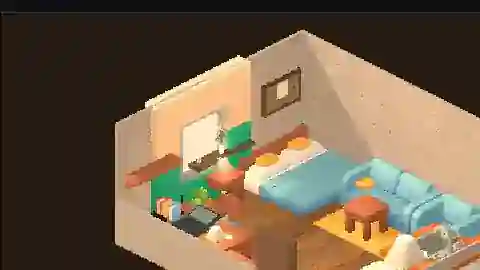

INDEPENDENT GAME × PIXEL TECHNICAL ART × INTERACTIVE NARRATIVE

<h1 align="center">A F T E R I M A G E · 余像</h1>

<b>一个真实的 3D 世界，两种观看它的方式。</b> Godot · 3D Pixel Art · Spatial Narrative · Stateful Interaction

> **2026.10.18 · 研发阶段展示 / Work in Progress。** 这是从真实 Godot 工程与有边界的实验记录整理出的技术美术展示，不是已完成的游戏、最终美术或公开完整源码。

<b>REAL GODOT ENGINE CAPTURE</b> · VI Gate 3 / Apartment A / 30° elevation · authentic panel crop, web preview compressed for the portfolio · Human Art Review PENDING

## 01 / 为什么做《余像》

《余像》是一款围绕**记忆、日常生活与人与人工智能之间的关系**展开的独立游戏。开端不是惊悚事件，而是普通的个人空间、校园、人与物的熟悉关系。玩家日复一日使用电脑、照料百合、留下一些便签；这些熟悉的物件在之后成为记忆与身份问题的入口。

核心设计问题：**当一个存在的行为可以被技术机制解释时，人与它之间产生的关系是否因此不真实？**

## 02 / 场景与视觉研究

### 实时三维 → 等角像素观感

- 整个生活世界采用真实 3D Mesh、真实世界坐标、碰撞、材质与交互锚点；不使用纯 2D TileMap 代替可探索建筑。
- 日常探索采用 45° 水平方位、约 30° 俯角的正交 Camera3D，480×270 原生像素基线，Nearest 倍率放大。
- 针对室内制作 **Dollhouse Cutaway / Full Interior** 两套视觉呈现：探索时剖面可见室内，近距离第一人称时恢复完整结构。
- 第一人称检查为同一套三维物件的第二种观察方式：目标是能够绕看 Lily、电脑、手机等物体，而不需要复制一套“假房间”。
- 480×270 下小道具易失去辨识度，单纯给低模加像素滤镜也无法得到精致像素画；目前正在研究像素密度、PBR 材质层次、场景空间与相机稳定性。

**真实截图说明：** 2026-10-16 的 Gate 3 已在 Godot 4.7.2 的窗口化 Vulkan/Forward+ 运行中拍摄 Apartment A/B，以及 28.25° / 30° / 35.26° / 45° 四个俯角。图片是 *visual candidates*，并未通过最终人工美术审核。Apartment A 更紧凑，B 更宽敞，但 B 仍需重新组织布局；并非简单“B 优于 A”。

### Personal objects / 个人痕迹

| 对象 | 空间意义 |
|:--|:--|
| Lily · 百合 | 初期普通、稳定的真实植物；后续变化服从已冻结的叙事合同 |
| Laptop / PC | 玩家工作与个人 Agent 交互的入口 |
| Cup, notes, noticeboard | 喝水习惯、任务、学习与日常生活 |
| Old phone, headphones, backpack | 个人生活的持续性与留存痕迹 |

Visual Identity 隔离实验已经用声明式支撑面规则接入 **10 件个人物品**，并记录它们与窗台、桌面、地面、椅背和原交互锚点之间的关系。**位置验证不等于物件的最终视觉验收。**

## 03 / 技术架构与已验证边界

| 子系统 | 实际阶段 / 研究内容 |
|---|---|
| **Godot 4.7.2 / Forward+** | 真实 3D 场景、SubViewport、正交 Camera3D、像素化输出 |
| **G0 Game Framework** | GameState / Save、SceneRouter、GameModes、EventBus、DialogueService、ContentDB、数据驱动事件、互动与持久化世界状态的基础框架 |
| **Art & Asset Reuse** | 隔离导入 KayKit 家具和 Poly Haven CC0 材质，记录来源、模型格式、贴图 SHA、尺度及碰撞的实际接管关系 |
| **Visual Identity Overlay / VI Gate 2** | Apartment A/B 的 10 件个人物品；报告记录 60/60 位置及结构检查、98/98 合同引文检查；不等于美术通过 |
| **Camera Research / VI Gate 3** | 真实 Godot 窗口截图：45° azimuth、四种 elevation、A/B 房间对照；主生活视角暂选 30° |
| **Spacious Apartment C / ongoing** | 从狭窄的 6×5m 候选转向约 8×6m 的多区生活公寓；全景、受限跟随、分区相机已有实验运行数据，完整第一人称与真实键盘试玩仍在继续 |
| **First-person 3D pixel inspection** | 明确的研发目标，不能把设计方案当作已完成的全流程交互 |
| **G2 Spatial / Interaction** | 具有独立验证与封存流程的持续研发线；发布与集成状态不能从某次单项测试直接推断 |

设计约束：**同一个 GameState、同一个世界对象、同一份空间身份，只改变玩家观察世界的镜头与视觉呈现。**

## 04 / Technical Art 方法

**从视觉目标反推可测量技术约束：**

1. **Reference → Spatial Composition**：以等角像素生活游戏为空间组织参考，但所有地图、家具、角色和素材必须原创或合法授权；不复制既有商业游戏的贴图与源码。
2. **3D Asset → Godot Import**：授权核查、网格尺度、法线、贴图与真实材质，区分资产可导入与资产真的在镜头里可读。
3. **Layout → Collision & Reachability**：真实角色碰撞与连通性检查，记录可达区域、家具造成的阻塞与交互接近距离。
4. **Camera → Pixel Stability**：正交尺寸、区域构图、整数放大、镜头移动的像素稳定性；真实角色走动仍需人工观察。
5. **Runtime Evidence → Human Art Review**：窗口化真实运行截图与录屏，明确保留失败项；自动化 PASS 不代表美术 PASS。

一项明确的失败案例：Apartment A2 某次布局调整留下约 **2.18m² 不可达空间**，尽管静态布置检查已通过。它推动了 Apartment C 的空间重新设计，**不应被包装为全部可玩性已通过**。

## 05 / 当前状态 · 2026-10-18

- **可展示：** 真实 Godot 公寓 A/B 正交像素截图、像素相机俯角对照、Lily 与家具试装、完整 G0 基础框架与有据可查的技术探索。
- **进行中：** 更宽敞的 Apartment C；受限跟随及区域相机；同一真实 3D 世界内的第一人称检查接入、窗口化试玩与镜头切换。
- **未宣称完成：** 整体视觉 Art PASS、可发布成品、正式 G2 Gate 完成、完整双视角游玩闭环以及所有地图的正式资产替换。

**方法关键词：** Godot / GDScript / Python / 3D Pixel Rendering / Shader R&D / Camera Rig / Scene Graph / Interaction System / Collision & Reachability / Visual Evidence / Git Isolation.

---

Personal game & technical-art research · Research Prototype / Work in Progress · Real engine evidence, not AI concept art passed off as gameplay.

